# animated-profile-header

Generate a self-contained animated SVG header for your GitHub profile README.
No runtime dependencies, no external services, no tracking — just a single
Node script that writes two SVG files (dark + light).



## Features

- Animated: name fades in, tagline types out with a blinking cursor, a light
  sweep crosses the bottom edge, and a status dot pulses.
- Dark and light variants, matched to GitHub's color tokens.
- Everything is inline CSS inside the SVG, so the files stay small (a few KB)
  and render on GitHub without JavaScript.
- Fully parameterized — name, tagline, meta line, handle and accent colors.

## Usage

Requires Node 18+.

```bash
node generate.mjs \
  --name "muriel" \
  --tag "backend engineer" \
  --meta "TypeScript · Python" \
  --handle "ghidrat" \
  --out ./dist
```

This writes `dist/header-dark.svg` and `dist/header-light.svg`.

### Embed in your README

```html
<picture>
  <source media="(prefers-color-scheme: dark)" srcset="dist/header-dark.svg">
  
</picture>
```

## Options

| Flag             | Default             | Description                          |
|------------------|---------------------|--------------------------------------|
| `--name`         | `your name`         | Large display name                   |
| `--tag`          | `software engineer` | Typed tagline                        |
| `--meta`         | *(empty)*           | Small text, top-right                 |
| `--handle`       | *(empty)*           | Small text next to the status dot     |
| `--out`          | `./dist`            | Output directory                     |
| `--accent`       | `#58a6ff`           | Primary accent (dark theme)          |
| `--accent2`      | `#bc8cff`           | Secondary accent (dark theme)        |
| `--accentLight`  | `#0969da`           | Primary accent (light theme)         |
| `--accent2Light` | `#8250df`           | Secondary accent (light theme)       |

## License

MIT
